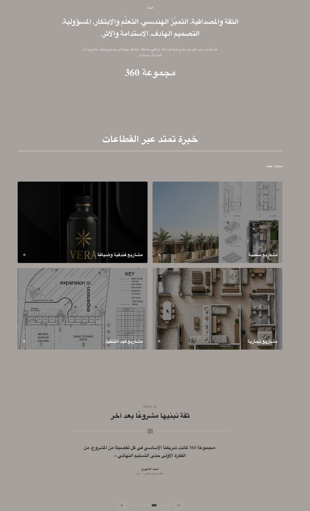

# 360 Engineering Group — Official Website

A modern engineering company portfolio website showcasing the company's expertise, values, projects, and industry experience.

**Live Website:** [360eng-group.com](https://360eng-group.com/)  
**Project Type:** Corporate Website & Portfolio  
**Framework:** Next.js  
**Language:** TypeScript  
**Styling:** Tailwind CSS and custom CSS  
**Animation:** GSAP  
**CMS:** Payload CMS  
**Database:** Neon PostgreSQL  
**Source Code:** Private

## Overview

The 360 Engineering Group website was developed to establish a professional online presence for a multidisciplinary engineering and contracting company serving the engineering and construction sec[...]

The website presents the company's identity, showcases selected projects, communicates its values, highlights its experience across different industries, and displays client testimonials.

The design combines architectural imagery, modern layouts, and animated interface elements to create a polished corporate presentation.

## Features

### Animated Hero Section
- Large architectural image showcasing a modern building.
- Animated company name and visual elements.
- Modern styling designed to establish a strong first impression.

### About Us
Introduces the company and communicates its identity, capabilities, and professional focus.

### Featured Projects
Showcases selected engineering and construction projects through visual presentation and project information.

### Company Values
Presents the principles that guide the company's work and professional approach.

### Industry Experience
The **"خبرة تمتد عبر القطاعات"** section highlights the different sectors in which the company operates.

### Client Testimonials
Displays testimonials that help communicate client experiences and build trust.

### Responsive Design
Adapts the website layout to different screen sizes, including desktop, tablet, and mobile devices.

## Technology Stack

- **Next.js:** Website framework and rendering.
- **TypeScript:** Type-safe application development.
- **Tailwind CSS:** Utility-first styling.
- **GSAP:** Animation and motion effects.
- **Payload CMS:** Content management and backend functionality.
- **Neon PostgreSQL:** Hosted relational database.
- **Git and GitHub:** Version control and collaboration.

## Technical Highlights

### Animation and Visual Design

GSAP is used to create animated interface elements, complementing the architectural imagery and modern visual style.

### Content Management

Payload CMS provides the content-management layer, allowing supported website content to be managed through an administrative interface rather than hardcoded into the frontend.

### Database Integration

Neon PostgreSQL provides the relational database used by the application through its configured backend integration.

### Responsive User Interface

The website combines Tailwind CSS and custom styling to deliver a consistent layout across supported screen sizes.

## My Contribution

I developed the website's frontend experience and integrated the technologies used to deliver the project.

My work included:

- Implementing the website's visual layout and sections.
- Building the animated hero experience.
- Developing the featured projects, company values, industry sectors, and testimonials sections.
- Integrating GSAP animations.
- Implementing responsive styling using Tailwind CSS and custom CSS.
- Working with Payload CMS for content management.
- Integrating the application with the Neon PostgreSQL database.

## Source Code

The source code is maintained in a private repository. This public repository documents the project, its technology stack, key features, and my contribution without exposing private implementation[...]

## Links

- **Live Website:** [https://360eng-group.com/](https://360eng-group.com/)
